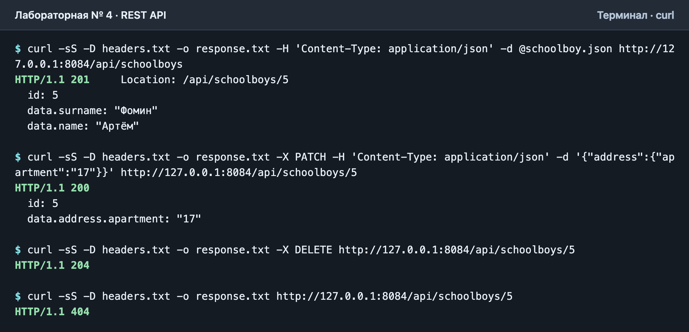
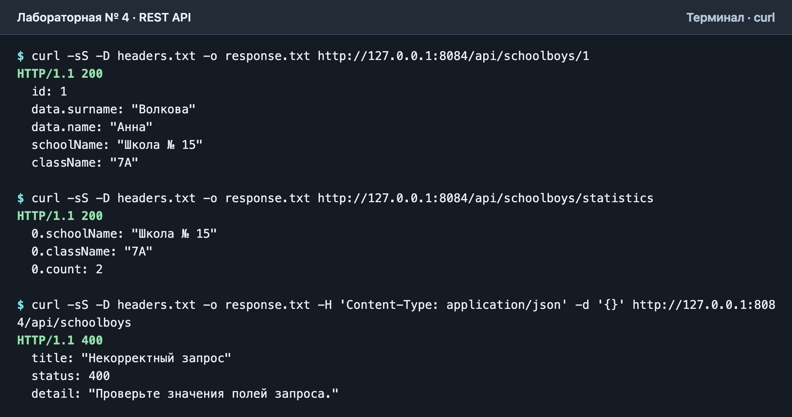

# Лабораторная работа № 4. REST API

## Цель работы

Реализовать REST API для школьников по варианту 2. Предоставить CRUD, частичное обновление и статистику по школам и классам.

## Архитектура проекта

- **Стек:** Java 17, Spring Boot 3.5.16, Maven Wrapper, Spring MVC, Spring Data JPA, Jackson, Jakarta Validation.
- **СУБД:** H2 в памяти. При перезапуске восстанавливаются демонстрационные данные.
- **Основные слои:**
  - **Controller** — `SchoolboyController` обслуживает JSON-маршруты `/api/schoolboys` и `/api/schools`. `ApiErrors` формирует ответы об ошибках.
  - **Service** — `SchoolboyService` проверяет связь школы и класса и управляет транзакциями. `SchoolboyPatch` применяет частичные изменения.
  - **Repository** — `JpaSchoolboyStore` использует `EntityManager` и JPQL для чтения, записи и формирования статистики.
- **Ключевые аннотации:** `@RestController`, `@RequestBody`, `@PatchMapping`, `@RestControllerAdvice`, `@Entity`, `@Transactional`, `@Valid`.
- **Описание моделей данных и DTO**
  - JPA-сущности `Schoolboy`, `Address`, `School` и `SchoolClass` хранят личные данные, домашний адрес, школу и класс.
  - `SchoolboyData` принимает личные данные, `schoolId`, `classId` и вложенный `AddressData`. `SchoolboyView` добавляет к этим данным идентификатор и названия школы и класса.
  - `Catalog` содержит списки `SchoolInfo` и `ClassInfo`. `ClassStatistics` возвращает количество школьников по школе и классу.

## Алгоритм работы

1. Получить доступные школы и классы через `GET /api/schools`.
2. Передать данные школьника в JSON. Запрос POST создаёт запись и возвращает HTTP 201, а PUT заменяет её данные. PATCH изменяет только переданные поля.
3. Получить карточку или статистику. Запрос DELETE удаляет школьника и его адрес и возвращает HTTP 204.
4. Проверить ошибки. Некорректный JSON, недопустимые значения или класс другой школы дают HTTP 400. Для отсутствующего ID сервер возвращает HTTP 404.

| Метод | Маршрут | Успешный результат |
| --- | --- | --- |
| GET | `/api/schools` | Каталог школ и классов, 200 |
| GET | `/api/schoolboys` | Список школьников, 200 |
| POST | `/api/schoolboys` | Новая карточка и заголовок `Location`, 201 |
| GET | `/api/schoolboys/{id}` | Карточка по ID, 200 |
| PUT | `/api/schoolboys/{id}` | Полная замена данных, 200 |
| PATCH | `/api/schoolboys/{id}` | Частичное обновление, 200 |
| DELETE | `/api/schoolboys/{id}` | Удаление, 204 |
| GET | `/api/schoolboys/statistics` | Количество школьников по школам и классам, 200 |

## Скриншоты результатов тестирования (curl или Postman)

**Создание, частичное изменение, удаление и ответ для удалённой записи**

**Чтение карточки, статистика и проверка ошибок валидации**

