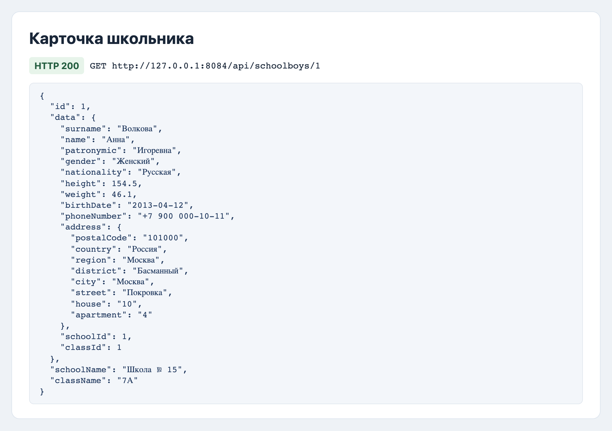
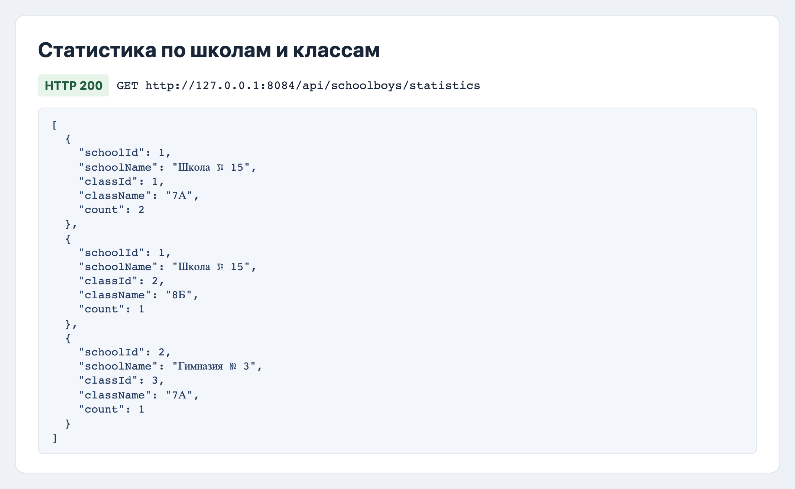

# Лабораторная работа № 4. REST API

## Цель работы

Реализовать REST API для варианта 2 «Школьник». Предоставить CRUD, частичное обновление и статистику по школам и классам.

## Архитектура проекта

Стек включает Java 17, Spring Boot 3.5.16, Maven Wrapper и Spring MVC, Spring Data JPA, H2, Jackson, Jakarta Validation.

- REST-контроллер принимает и возвращает JSON. Обработка ошибок формирует русскоязычные сообщения.
- Сервис проверяет связь школы и класса и управляет транзакциями. Репозиторий использует `EntityManager` и JPQL.
- Для изменения записи репозиторий блокирует её на время транзакции. Адрес принадлежит школьнику и удаляется вместе с ним.
- Аннотации `@RestController`, `@RequestBody`, `@PatchMapping`, `@Entity`, `@Transactional`, `@Valid`.

## Алгоритм работы

1. Получите доступные школы и классы на `GET /api/schools`.
2. Выполните действия со школьниками по таблице ниже.
3. Проверьте формат запроса и сверьте статус ответа. Некорректный JSON, поля или сочетание школы и класса дают HTTP 400. Для отсутствующего идентификатора возвращается HTTP 404.

| Метод | URL | Результат |
| --- | --- | --- |
| GET | `/api/schoolboys` | Список, 200 |
| POST | `/api/schoolboys` | Новая запись, 201 и заголовок Location |
| GET | `/api/schoolboys/{id}` | Карточка, 200 |
| PUT | `/api/schoolboys/{id}` | Замена данных, 200 |
| PATCH | `/api/schoolboys/{id}` | Изменение указанных полей, 200 |
| DELETE | `/api/schoolboys/{id}` | Удаление, 204 |
| GET | `/api/schoolboys/statistics` | Число школьников по школе и классу, 200 |

POST и PUT принимают объект с личными данными, `schoolId`, `classId` и вложенным `address`. Ответ содержит идентификатор, этот объект в поле `data` и названия школы и класса. PATCH поддерживает частичное изменение полей адреса.

```bash
base=http://127.0.0.1:8084
curl -i "$base/api/schools"
curl -i "$base/api/schoolboys"
curl -i "$base/api/schoolboys/1"
cat > schoolboy.json <<'JSON'
{
  "surname": "Фомин", "name": "Артём", "patronymic": "Олегович",
  "gender": "Мужской", "nationality": "Русский", "height": 156.5, "weight": 48.0,
  "birthDate": "2013-04-15", "phoneNumber": "+7 900 000-44-01",
  "schoolId": 1, "classId": 1,
  "address": {
    "postalCode": "101000", "country": "Россия", "region": "Москва",
    "district": "Басманный", "city": "Москва", "street": "Покровка", "house": "8"
  }
}
JSON
created=$(curl -sS --fail -H 'Content-Type: application/json' \
  --data-binary @schoolboy.json "$base/api/schoolboys")
id=$(printf '%s' "$created" | python3 -c 'import json, sys; print(json.load(sys.stdin)["id"])')
curl -i -X PUT -H 'Content-Type: application/json' --data-binary @schoolboy.json "$base/api/schoolboys/$id"
curl -i -X PATCH -H 'Content-Type: application/json' -d '{"address":{"apartment":"17"}}' "$base/api/schoolboys/$id"
curl -i "$base/api/schoolboys/statistics"
curl -i -X DELETE "$base/api/schoolboys/$id"
```

## Запуск в IntelliJ IDEA

1. Откройте папку с файлом `pom.xml` в IntelliJ IDEA и дождитесь импорта Maven.
2. В **File → Project Structure → Project SDK** выберите JDK 17, если среда ещё не выбрала его.
3. Выберите конфигурацию **Лабораторная 4** и нажмите **Run**. Откройте [страницу приложения](http://127.0.0.1:8084/api/schoolboys/1).

Данные H2 находятся в памяти. После перезапуска восстанавливаются демонстрационные записи.

Для проверки проекта из терминала выполните `./mvnw clean verify`.

## Скриншоты работы приложения

**Получение карточки школьника**



**Статистика по школам и классам**


